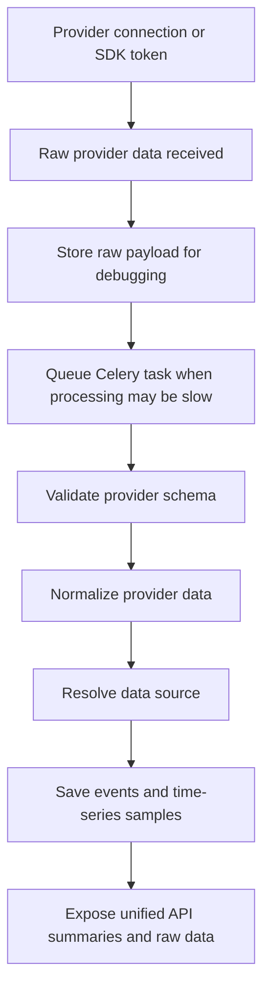
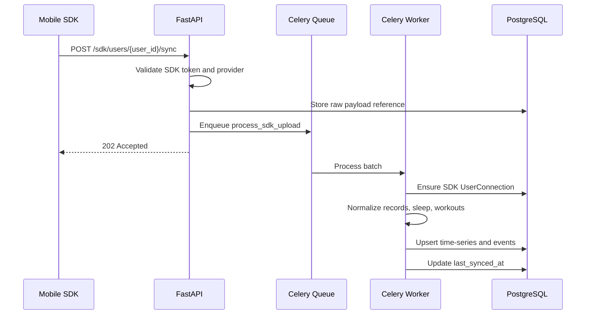
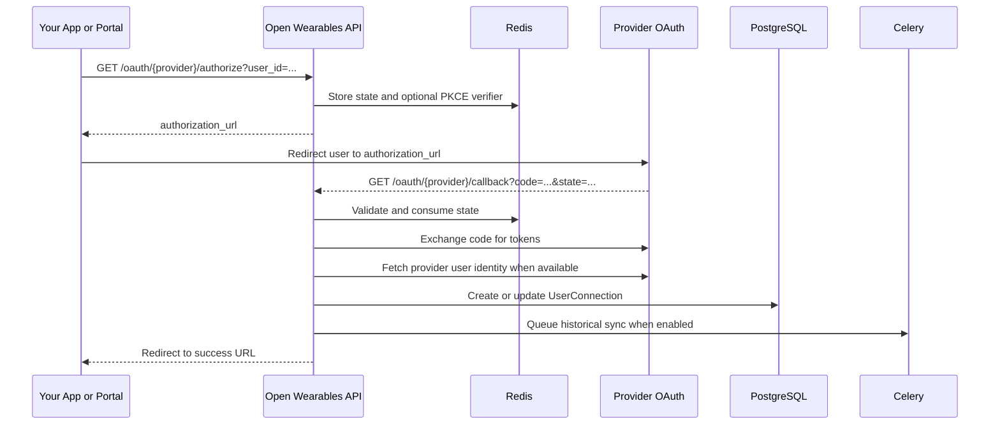
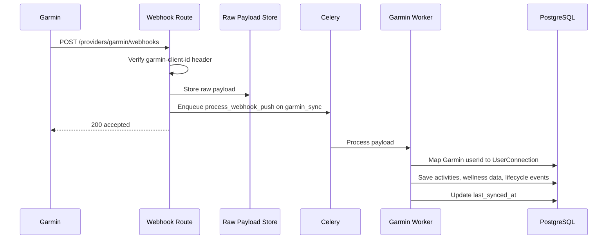
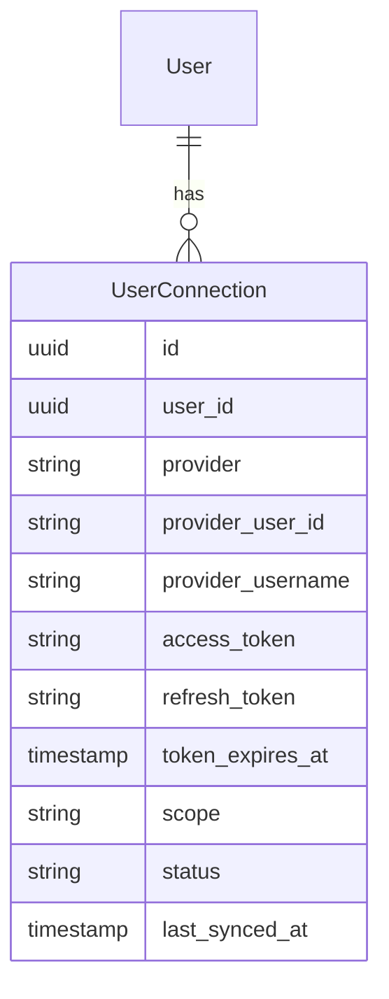
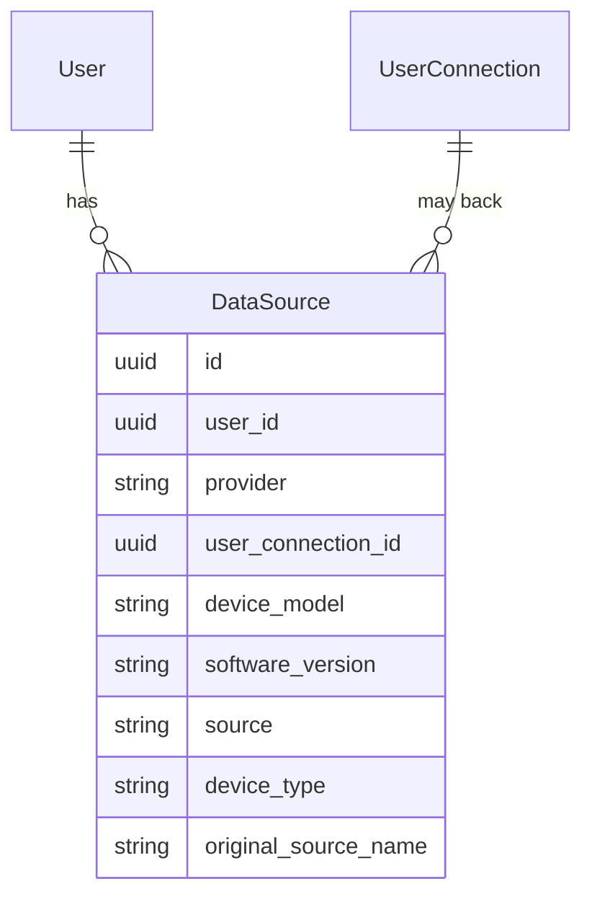
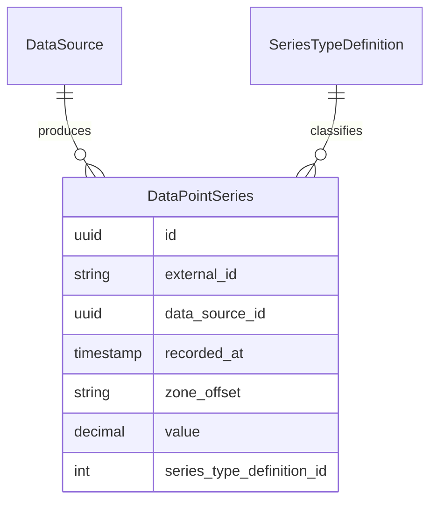
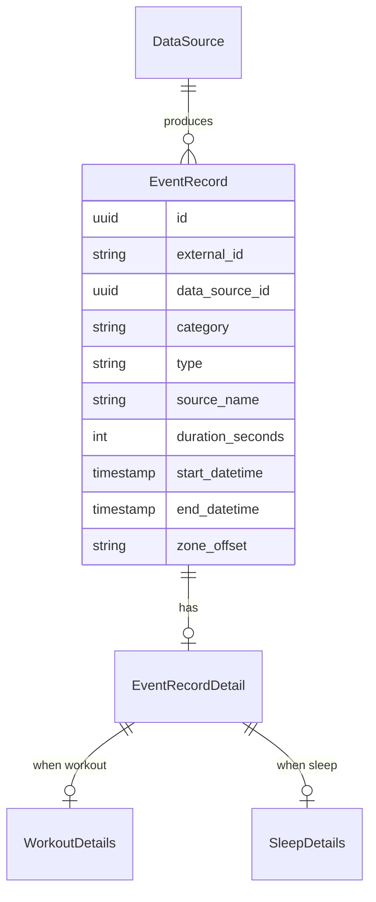

## Overview

This guide explains how Open Wearables connects to wearable data sources and turns provider-specific data into a unified model. It is intended for teams building a similar product: a backend that can connect Apple Health, Android health stores, Garmin, Strava, Suunto, and other sources while keeping the resulting data queryable through one API.

Open Wearables does not treat every provider as the same kind of integration. The most important architectural decision is to separate providers by **delivery mode**:

| Delivery mode | Used by | How data reaches Open Wearables |
|---|---|---|
| Mobile SDK push | Apple HealthKit, Samsung Health, Google Health Connect | A mobile app reads local health data and uploads it to the backend |
| File import | Apple Health XML export | User uploads an exported XML file directly or through S3 |
| OAuth REST pull | Strava, Suunto, Polar, Whoop, Oura, Fitbit | User authorizes the app, backend stores tokens, backend pulls historical or recent data |
| Webhook stream | Garmin, Suunto | Provider sends full data payloads to Open Wearables webhooks |
| Webhook ping | Strava, Oura, Fitbit, Polar | Provider sends a lightweight notification, then backend fetches full data through REST |
| Webhook callback / backfill | Garmin | Backend requests an export, provider later delivers payloads through webhooks |

<Note>
Apple Health and Android health stores are not cloud APIs in this architecture. The backend cannot directly ask Apple HealthKit or Google Health Connect for a user's data. A mobile client must request user permissions, read local data, and push it to the server.
</Note>

## High-Level Flow

All providers eventually enter the same internal pipeline:



The normalized data is stored in two main forms:

| Normalized form | Purpose | Examples |
|---|---|---|
| `DataPointSeries` | Point-in-time or time-series measurements | Heart rate, steps, HRV, SpO2, weight, energy, body temperature |
| `EventRecord` + details | Time-bounded events | Workouts, sleep sessions, health snapshots |

## Core Backend Components

The backend uses a layered architecture:

| Layer | Location | Responsibility |
|---|---|---|
| API routes | `backend/app/api/routes/v1` | HTTP endpoints for OAuth, SDK sync, provider sync, webhooks, summaries |
| Provider strategies | `backend/app/services/providers/{provider}/strategy.py` | Declare provider identity, capabilities, and handlers |
| OAuth handlers | `backend/app/services/providers/{provider}/oauth.py` | Authorization URL, callback, token exchange, token refresh |
| Data handlers | `backend/app/services/providers/{provider}/workouts.py`, `data_247.py` | Fetch, parse, normalize, and save provider data |
| Webhook handlers | `backend/app/services/providers/{provider}/webhook_handler.py` | Verify signatures, parse events, enqueue or process payloads |
| Repositories | `backend/app/repositories` | Database access, upsert, deduplication, pagination |
| Celery tasks | `backend/app/integrations/celery/tasks` | Async imports, provider syncs, webhook processing, backfills |

Each provider is accessed through a `ProviderFactory`, which returns a `BaseProviderStrategy` implementation. The strategy declares what the provider supports through `ProviderCapabilities`.

```python filename="backend/app/services/providers/base_strategy.py"
ProviderCapabilities(
    rest_pull=True,
    client_sdk=False,
    file_import=False,
    webhook_callback=False,
    webhook_stream=False,
    webhook_ping=False,
    max_historical_days=None,
)
```

This avoids hardcoding sync behavior in routes. The sync scheduler and webhook router can inspect provider capabilities and choose the correct path.

## Provider Capability Matrix

| Provider | Connection type | Main data path | Historical sync | Live sync |
|---|---|---|---|---|
| Apple Health | SDK token or XML import | Mobile SDK payload or XML file | Mobile app uploads historical data, or XML import | Mobile app pushes new data |
| Samsung Health | SDK token | Mobile SDK payload | Mobile app uploads historical data | Mobile app pushes new data |
| Google Health Connect | SDK token | Mobile SDK payload | Mobile app uploads historical data | Mobile app pushes new data |
| Garmin | OAuth with PKCE | Webhook stream | Garmin webhook-based backfill, limited by provider | Webhook payloads |
| Strava | OAuth | REST pull for activities | REST pull using date window | Webhook ping, then REST fetch |
| Suunto | OAuth + subscription key | REST pull and webhook stream | REST pull | Webhook payloads |

## Apple Health, Samsung Health, and Google Health Connect

### Why They Use Mobile SDK Push

Apple HealthKit, Samsung Health, and Google Health Connect store health data on the user's device or OS-level health store. The backend cannot query those stores directly. The mobile app must:

1. Request user permission for specific health data types.
2. Read records from HealthKit, Samsung Health, or Health Connect.
3. Convert records into Open Wearables' SDK payload format.
4. Upload batches to the backend with a user-scoped SDK token.

### SDK Token Flow

The backend creates a token scoped to one user:

```http
POST /api/v1/users/{user_id}/token
Authorization: Bearer <developer_access_token>
Content-Type: application/json

{}
```

Or the request can use application credentials:

```json
{
  "app_id": "app_123456",
  "app_secret": "store-this-in-your-mobile-backend-not-in-the-app"
}
```

The response contains an access token and refresh token:

```json
{
  "access_token": "eyJhbGciOi...",
  "token_type": "bearer",
  "refresh_token": "rt_abc123",
  "expires_in": 3600
}
```

<Warning>
Do not embed long-lived application secrets directly in a public mobile app. In production, issue user-scoped SDK tokens from your own trusted backend, then pass only the short-lived token to the mobile client.
</Warning>

### Optional Invitation Code Flow

Open Wearables also supports a user onboarding flow where a developer generates a one-time invitation code. A mobile user redeems it to receive SDK tokens without manually entering a user ID.

```http
POST /api/v1/users/{user_id}/invitation-code
Authorization: Bearer <developer_access_token>
```

```http
POST /api/v1/invitation-code/redeem
Content-Type: application/json

{
  "code": "ABCD-EFGH"
}
```

### SDK Sync Endpoint

The mobile app sends data to:

```http
POST /api/v1/sdk/users/{user_id}/sync
Authorization: Bearer <sdk_user_access_token>
Content-Type: application/json
```

Complete example:

```json
{
  "provider": "apple",
  "sdkVersion": "1.0.0",
  "syncTimestamp": "2026-02-24T10:00:00Z",
  "data": {
    "records": [
      {
        "id": "hr-2026-02-24T08:30:00Z",
        "type": "HEART_RATE",
        "startDate": "2026-02-24T08:30:00Z",
        "endDate": "2026-02-24T08:30:00Z",
        "zoneOffset": "+01:00",
        "source": {
          "appId": "com.apple.health",
          "deviceName": "Apple Watch",
          "deviceManufacturer": "Apple",
          "deviceModel": "Watch7,4",
          "deviceType": "watch",
          "recordingMethod": "automatic"
        },
        "value": 72,
        "unit": "bpm",
        "metadata": null
      }
    ],
    "sleep": [
      {
        "id": "sleep-stage-001",
        "parentId": "sleep-night-001",
        "stage": "deep",
        "startDate": "2026-02-23T23:30:00Z",
        "endDate": "2026-02-24T00:20:00Z",
        "zoneOffset": "+01:00",
        "source": {
          "deviceName": "Apple Watch",
          "deviceManufacturer": "Apple",
          "deviceModel": "Watch7,4",
          "deviceType": "watch"
        },
        "values": null,
        "metadata": null
      }
    ],
    "workouts": [
      {
        "id": "workout-001",
        "type": "RUNNING",
        "startDate": "2026-02-24T06:00:00Z",
        "endDate": "2026-02-24T06:45:00Z",
        "zoneOffset": "+01:00",
        "source": {
          "deviceName": "Apple Watch",
          "deviceManufacturer": "Apple",
          "deviceModel": "Watch7,4",
          "deviceType": "watch"
        },
        "title": "Morning run",
        "values": [
          { "type": "duration", "value": 2700000, "unit": "ms" },
          { "type": "calories", "value": 345.5, "unit": "kcal" },
          { "type": "distance", "value": 5234.0, "unit": "m" },
          { "type": "meanHeartRate", "value": 142.3, "unit": "bpm" }
        ]
      }
    ]
  }
}
```

Expected response:

```json
{
  "status_code": 202,
  "response": "Import task queued successfully",
  "user_id": "8c6f91b7-2f6e-4a7a-8fb8-5a9bbd0e6c11"
}
```

### SDK Processing Pipeline



The import service maps:

| Incoming section | Normalized storage |
|---|---|
| `data.records` | `DataPointSeries` |
| `data.workouts` | `EventRecord` with `WorkoutDetails`, plus optional time-series samples |
| `data.sleep` | Redis-backed session state, then `EventRecord` with `SleepDetails` |

### Sleep Session Handling

Sleep data often arrives as many small stage segments. Open Wearables does not immediately assume each segment is a full sleep session. It:

1. Sorts stage segments by start time.
2. Deduplicates repeated segments.
3. Keeps active sleep session state in Redis.
4. Merges segments while the gap between segments is below `SLEEP_END_GAP_MINUTES`.
5. Finalizes stale sessions into a single `EventRecord` with `SleepDetails`.
6. Stores detailed stage intervals in `sleep_stages` JSONB.

This design is important for Apple Health because one night of sleep may arrive in multiple payloads and in partial order.

## Apple Health XML Import

Apple Health also supports user-exported XML files. Open Wearables exposes:

```http
POST /api/v1/users/{user_id}/import/apple/xml/direct
```

and an S3 presigned URL flow:

```http
POST /api/v1/users/{user_id}/import/apple/xml/s3
```

Use XML import for bulk personal exports. Use SDK sync for continuous app-driven sync.

## OAuth Providers

Cloud providers such as Garmin, Strava, Suunto, Polar, Whoop, Oura, Fitbit, and Ultrahuman are connected through provider-specific strategies.

### OAuth Authorization Flow



### Authorization URL Endpoint

```http
GET /api/v1/oauth/strava/authorize?user_id=8c6f91b7-2f6e-4a7a-8fb8-5a9bbd0e6c11&redirect_uri=https://app.example.com/connected
```

Response:

```json
{
  "authorization_url": "https://www.strava.com/oauth/authorize?response_type=code&client_id=123&redirect_uri=...",
  "state": "secure-random-state"
}
```

### Token Storage

After callback, the backend saves or updates `UserConnection`:

| Field | Meaning |
|---|---|
| `user_id` | Internal Open Wearables user |
| `provider` | Provider name, for example `garmin` or `strava` |
| `provider_user_id` | Provider-specific user identifier |
| `provider_username` | Provider-specific username when available |
| `access_token` | OAuth access token, encrypted or protected by deployment security |
| `refresh_token` | OAuth refresh token |
| `token_expires_at` | Expiration timestamp |
| `scope` | Granted provider permissions |
| `status` | `active` or `revoked` |
| `last_synced_at` | Cursor for live pull sync |

### Token Refresh

Every provider REST call goes through `make_authenticated_request`. Before calling the provider API it:

1. Looks up the user's active connection.
2. Checks whether the access token expires within the next 5 minutes.
3. Refreshes the token with the provider OAuth handler when needed.
4. Retries rate-limited requests using exponential backoff.
5. Raises a clear authorization error if the user must reconnect.

## Garmin Integration

Garmin uses OAuth 2.0 with PKCE and a webhook-first data pipeline.

### Garmin Capabilities

```python filename="backend/app/services/providers/garmin/strategy.py"
return ProviderCapabilities(
    webhook_stream=True,
    webhook_callback=True,
    max_historical_days=30,
)
```

Garmin supports:

| Data type | Handling |
|---|---|
| Activities/workouts | Delivered through webhooks, normalized into `EventRecord` + `WorkoutDetails` |
| Dailies | Delivered through webhooks, normalized into `DataPointSeries` |
| Epochs | Delivered through webhooks, normalized into time-series samples |
| Sleep | Delivered through webhooks, normalized into `EventRecord` + `SleepDetails` |
| HRV, stress, respiration, pulse ox, body battery, body composition | Delivered through webhooks and saved as time-series samples |
| Historical data | Garmin backfill flow, delivered asynchronously through webhooks |

### Garmin Webhook Flow



The webhook handler returns quickly because Garmin enforces provider-side timeouts. Heavy processing happens in Celery.

### Garmin Backfill

Garmin historical sync is different from normal REST polling. Open Wearables starts a backfill and tracks progress in Redis. The provider later delivers data by webhook. The API exposes status and retry endpoints:

```http
GET /api/v1/providers/garmin/users/{user_id}/backfill/status
POST /api/v1/providers/garmin/users/{user_id}/backfill/cancel
POST /api/v1/providers/garmin/users/{user_id}/backfill/{type_name}/retry
```

Valid Garmin backfill types include `sleeps`, `dailies`, `activities`, `activityDetails`, and `hrv`.

## Strava Integration

Strava is activity-focused. It does not provide sleep, HRV, daily summaries, or continuous health monitoring in the same way as Garmin or Apple Health.

### Strava Capabilities

```python filename="backend/app/services/providers/strava/strategy.py"
return ProviderCapabilities(rest_pull=True)
```

The implementation currently uses REST pull for historical data. Webhooks are implemented through provider-specific routes and act as notify-only events.

### Strava OAuth

Strava expects client credentials in the token request body. The recommended scopes are:

| Scope | Purpose |
|---|---|
| `activity:read` | Read public activities |
| `activity:read_all` | Read all activities, including private activities |
| `profile:read_all` | Read athlete profile and map provider user ID |

### Strava Historical Pull

For a date range, Open Wearables calls:

```http
GET https://www.strava.com/api/v3/athlete/activities
```

with parameters:

```json
{
  "after": 1771858800,
  "before": 1772463600,
  "page": 1,
  "per_page": 200
}
```

Each activity is normalized into:

| Strava field | Open Wearables field |
|---|---|
| `id` | `EventRecord.external_id` |
| `sport_type` or `type` | Unified workout type |
| `start_date` + `elapsed_time` | `start_datetime`, `end_datetime`, `duration_seconds` |
| `average_heartrate`, `max_heartrate` | `WorkoutDetails.heart_rate_avg`, `heart_rate_max` |
| `distance` | `WorkoutDetails.distance` |
| `average_speed`, `max_speed` | `WorkoutDetails.average_speed`, `max_speed` |
| `average_watts`, `max_watts` | `WorkoutDetails.average_watts`, `max_watts` |
| `total_elevation_gain` | `WorkoutDetails.total_elevation_gain` |
| `calories` or `kilojoules` | `WorkoutDetails.energy_burned` |

### Strava Webhook Ping

Strava webhooks send a lightweight event:

```json
{
  "object_type": "activity",
  "object_id": 123456789,
  "aspect_type": "create",
  "owner_id": 987654321,
  "subscription_id": 111,
  "event_time": 1771858800
}
```

The backend then:

1. Validates the webhook subscription challenge on setup.
2. Receives the event.
3. Ignores non-activity events.
4. Maps `owner_id` to `UserConnection.provider_user_id`.
5. Calls `GET /activities/{object_id}`.
6. Normalizes and saves the full activity.

## Suunto Integration

Suunto supports OAuth, REST pull, and webhook streaming.

### Suunto Capabilities

```python filename="backend/app/services/providers/suunto/strategy.py"
return ProviderCapabilities(rest_pull=True, webhook_stream=True)
```

### Suunto OAuth and Headers

Suunto uses OAuth 2.0 and requires an API subscription key for API calls.

Typical environment variables:

```bash
SUUNTO_CLIENT_ID=your-suunto-client-id
SUUNTO_CLIENT_SECRET=your-suunto-client-secret
SUUNTO_REDIRECT_URI=https://api.example.com/api/v1/oauth/suunto/callback
SUUNTO_DEFAULT_SCOPE=workout
SUUNTO_SUBSCRIPTION_KEY=your-suunto-subscription-key
```

Provider API requests include:

```http
Authorization: Bearer <access_token>
Ocp-Apim-Subscription-Key: <subscription_key>
Accept: application/json
```

### Suunto Historical Pull

Open Wearables fetches workouts from:

```http
GET https://cloudapi.suunto.com/v3/workouts/
```

with provider-specific parameters:

```json
{
  "since": 1771858800000,
  "limit": 100,
  "offset": 0,
  "filter-by-modification-time": true
}
```

The workout detail endpoint is:

```http
GET /v3/workouts/{workout_key}
```

### Suunto Webhook Stream

Suunto signs webhook requests with HMAC-SHA256 in the `X-HMAC-SHA256-Signature` header. The handler verifies the raw body before processing.

Supported event types include:

| Event type | Handling |
|---|---|
| `WORKOUT_CREATED` | Fetch canonical workout detail by `workoutKey`, then save as workout event |
| `SUUNTO_247_SLEEP_CREATED` | Save inline sleep samples |
| `SUUNTO_247_ACTIVITY_CREATED` | Save inline activity samples |
| `SUUNTO_247_RECOVERY_CREATED` | Save inline recovery samples |
| `ROUTE_CREATED` | Ignored by current implementation |

Like Garmin, Suunto webhooks are accepted quickly and processed in Celery.

## Historical Sync vs Live Sync

Open Wearables distinguishes **historical sync** from **live sync**.

### Historical Sync

Historical sync is explicit. It receives a date window and should not update the live cursor in a way that loses recent sync position.

```http
POST /api/v1/providers/{provider}/users/{user_id}/sync
Authorization: Bearer <api_key>
```

For providers with `rest_pull=True`, Celery calls provider handlers with the requested start and end date. For Garmin, historical sync starts a provider-specific backfill flow.

### Live Sync

Live sync should only fetch new data. The backend uses `UserConnection.last_synced_at` as the cursor:

1. If a provider is in pull mode, periodic sync starts from `last_synced_at`.
2. If `last_synced_at` is empty, live sync starts from now to avoid accidentally pulling all history.
3. After successful live sync, `last_synced_at` is updated.
4. Webhook and SDK providers update `last_synced_at` after successful processing.

<Warning>
Do not use live sync to backfill old data. Require explicit historical sync windows so you do not surprise providers, hit rate limits, or duplicate large volumes of data.
</Warning>

## Unified Data Model

### UserConnection

`UserConnection` represents a user's connection to one provider.



SDK-based providers also create a connection, but without OAuth tokens.

### DataSource

`DataSource` maps a user's provider and device/source combination to a stable ID. This keeps time-series rows narrow and helps with deduplication.



The unique identity is:

```text
user_id + provider + coalesce(device_model, "") + coalesce(source, "")
```

### DataPointSeries

`DataPointSeries` stores metric samples.



Examples:

| Metric | Series type | Canonical unit |
|---|---|---|
| Heart rate | `heart_rate` | `bpm` |
| Resting heart rate | `resting_heart_rate` | `bpm` |
| HRV RMSSD | `heart_rate_variability_rmssd` | `ms` |
| HRV SDNN | `heart_rate_variability_sdnn` | `ms` |
| Steps | `steps` | `count` |
| Active energy | `energy` | `kcal` |
| Weight | `weight` | `kg` |
| Oxygen saturation | `oxygen_saturation` | `percent` |

### EventRecord and Details

`EventRecord` stores time-bounded events.



Workout detail fields include heart rate aggregates, energy, distance, speed, power, elevation, and steps.

Sleep detail fields include total sleep, time in bed, efficiency, light/deep/REM/awake minutes, nap flag, and sleep stages.

## Normalization Rules

### Canonical Provider Adapter

Every provider handler should convert raw provider data into Open Wearables schemas:

| Raw provider object | Normalized schema |
|---|---|
| Workout/activity | `EventRecordCreate` + `EventRecordDetailCreate` |
| Sleep session | `EventRecordCreate` + `EventRecordDetailCreate` with `detail_type="sleep"` |
| Health metric sample | `TimeSeriesSampleCreate` |
| Provider user identity | `UserConnection.provider_user_id` / `provider_username` |
| Device/source metadata | `DataSource` identity |

### Units

Normalize values before storage. Examples:

| Input | Normalized value |
|---|---|
| Apple height in meters | Store as centimeters |
| Apple body fat ratio `0.18` | Store as percent `18` |
| Workout duration in milliseconds | Store as seconds |
| Strava kilojoules fallback | Convert to kcal approximation when calories are unavailable |
| Provider timestamps with local offset | Store timestamp plus `zone_offset` |

### Workout Types

Provider workout/activity types are mapped to a unified enum. For example:

| Provider value | Unified type |
|---|---|
| Apple `RUNNING` | `running` |
| Strava `Run` or `TrailRun` | `running` |
| Suunto activity ID for running | `running` |
| Garmin activity type for cycling | `cycling` |

Keep provider-specific mapping functions separate from ingestion logic so new mappings do not require changes to storage code.

## Deduplication and Idempotency

Wearable integrations must expect retries, partial payloads, duplicate webhook deliveries, and overlapping mobile sync batches.

Open Wearables uses database constraints and upserts:

| Table | Deduplication key | Behavior |
|---|---|---|
| `DataSource` | `user_id + provider + device_model + source` | Reuse existing source |
| `DataPointSeries` | `data_source_id + series_type_definition_id + recorded_at` | Upsert value, external ID, zone offset |
| `EventRecord` | `data_source_id + start_datetime + end_datetime` | Ignore duplicate insert or return existing record |

Use this principle in your own app:

<Check>
Provider ingestion should be idempotent. If the same provider payload is processed twice, the second pass should not create duplicate workouts, duplicate sleep sessions, or duplicate time-series samples.
</Check>

## Source Priority and Overlapping Data

Users may connect multiple providers that report the same metric. For example:

- Apple Watch and Garmin may both report steps.
- Apple Health and Oura may both report sleep.
- Garmin and a chest strap may both report heart rate.

Open Wearables stores data by source and applies priority when building summaries. It does not discard lower-priority raw data during ingestion.

Priority levels:

| Priority type | Purpose |
|---|---|
| Provider priority | Prefer one provider over another globally |
| Device type priority | Prefer watch over phone, chest strap over unknown, etc. |

Lower numeric priority means higher preference. Summaries group data by date and choose the highest-priority source for that date.

This lets you keep raw data for auditing while giving product APIs a clean answer.

## Raw Payload Storage

Every ingestion path should store raw provider payloads before normalization:

| Source | Why store raw payloads |
|---|---|
| SDK sync | Debug mobile SDK bugs and schema drift |
| Webhooks | Reprocess failed provider deliveries |
| OAuth REST pulls | Audit provider responses |
| XML uploads | Verify parser behavior |

Raw payload storage is especially useful when providers change schemas or send malformed edge cases.

## Outgoing Webhooks

After data is saved, Open Wearables can emit outgoing webhooks through Svix. Examples include:

| Event | Trigger |
|---|---|
| Connection created | A user completes OAuth |
| Time-series batch saved | Samples are inserted or updated |
| Workout created | Workout event and details are saved |
| Sleep created | Sleep session is finalized |

Emit outgoing events after the database transaction commits. This prevents consumers from receiving an event for data that later rolls back.

## API Surface for Consumers

Consumers usually need three kinds of APIs:

### Connections

```http
GET /api/v1/users/{user_id}/connections
DELETE /api/v1/users/{user_id}/connections/{provider}
```

Use this to show which providers a user has connected and whether each provider supports historical sync, REST pull, webhooks, or SDK sync.

### Raw Time-Series Data

```http
GET /api/v1/users/{user_id}/timeseries?start_time=2026-02-01&end_time=2026-02-08&types=heart_rate&types=steps
```

Response shape:

```json
{
  "data": [
    {
      "timestamp": "2026-02-24T08:30:00Z",
      "zone_offset": "+01:00",
      "type": "heart_rate",
      "value": 72,
      "unit": "bpm",
      "source": {
        "provider": "apple",
        "device": "Watch7,4"
      }
    }
  ],
  "pagination": {
    "has_more": false,
    "next_cursor": null,
    "previous_cursor": null,
    "total_count": 1
  },
  "metadata": {
    "sample_count": 1,
    "start_time": "2026-02-01T00:00:00Z",
    "end_time": "2026-02-08T00:00:00Z"
  }
}
```

### Summaries

```http
GET /api/v1/users/{user_id}/summaries/activity?start_date=2026-02-01&end_date=2026-02-08
GET /api/v1/users/{user_id}/summaries/sleep?start_date=2026-02-01&end_date=2026-02-08
GET /api/v1/users/{user_id}/summaries/body
GET /api/v1/users/{user_id}/summaries/data
```

Summaries should be optimized for product use. They can aggregate raw data, apply source priority, calculate activity minutes, merge workout aggregates, and return stable response shapes.

## Error Handling

Provider integrations fail often. Design for failure from the beginning.

| Failure | Recommended behavior |
|---|---|
| OAuth state expired | Return clear 400 and ask user to restart connection |
| Token expired | Refresh automatically before provider call |
| Refresh token invalid | Mark connection revoked and ask user to reconnect |
| Provider 429 | Retry with backoff and preserve sync cursor |
| Webhook signature invalid | Return 401 and log provider/action |
| Unknown webhook user | Return 200 for provider retry safety, log as `user_not_found` |
| Partial provider page failure | Save successful pages and report partial error when appropriate |
| Celery processing error | Capture error, retain raw payload, allow retry |
| Duplicate payload | Return success or no-op, do not create duplicate data |

<Warning>
For webhooks, read provider retry rules carefully. Some providers retry aggressively if you return non-2xx. For unknown users or unsupported events, it is often better to return 200 and log the issue.
</Warning>

## Security Considerations

Use the following baseline:

- Store OAuth client secrets only in server-side environment variables or a secrets manager.
- Never ship provider client secrets in a public mobile app.
- Use random OAuth `state` values and validate them once.
- Use PKCE for providers that require or support it.
- Store short-lived SDK access tokens and refresh tokens per user.
- Scope SDK tokens to a single Open Wearables user.
- Verify webhook signatures using raw request body bytes.
- Use constant-time signature comparisons for HMAC and token checks.
- Do not log access tokens, refresh tokens, API keys, or webhook secrets.
- Store raw payloads in restricted storage because they may contain health data.

## Implementation Blueprint for a Similar App

If you are building a similar system, implement the platform in this order:

<Steps>
  <Step title="Define your canonical data model">
    Create tables for users, provider connections, data sources, time-series samples, events, and event details. Make the canonical model provider-independent.
  </Step>

  <Step title="Build SDK ingestion first">
    Add a mobile sync endpoint that accepts records, sleep, and workouts. This unlocks Apple Health and Android health stores, which are otherwise inaccessible from the backend.
  </Step>

  <Step title="Add OAuth provider infrastructure">
    Implement authorization URL generation, callback handling, token storage, token refresh, and provider user ID mapping.
  </Step>

  <Step title="Create provider strategies">
    Give every provider a strategy that declares capabilities and wires OAuth, workout, 24/7 data, and webhook handlers.
  </Step>

  <Step title="Normalize one provider at a time">
    Start with workouts because they are easier to validate visually. Then add continuous health data, sleep, recovery, and body metrics.
  </Step>

  <Step title="Make ingestion asynchronous">
    Use a queue for SDK uploads, XML imports, webhook payloads, and historical syncs. Provider callbacks should return quickly.
  </Step>

  <Step title="Add idempotency and source priority">
    Add unique constraints and upserts before production. Store overlapping provider data, then choose preferred sources at summary time.
  </Step>

  <Step title="Expose product APIs">
    Provide raw time-series APIs for debugging and research, plus summary APIs for app screens and dashboards.
  </Step>
</Steps>

## Minimal Database Shape

For a first production-ready version, this is a practical minimum:

```sql
-- Users in your system
CREATE TABLE users (
  id UUID PRIMARY KEY,
  external_user_id TEXT,
  created_at TIMESTAMPTZ NOT NULL
);

-- One row per user/provider connection
CREATE TABLE user_connections (
  id UUID PRIMARY KEY,
  user_id UUID NOT NULL REFERENCES users(id),
  provider TEXT NOT NULL,
  provider_user_id TEXT,
  provider_username TEXT,
  access_token TEXT,
  refresh_token TEXT,
  token_expires_at TIMESTAMPTZ,
  status TEXT NOT NULL,
  last_synced_at TIMESTAMPTZ,
  UNIQUE (user_id, provider)
);

-- One row per user/provider/device/source
CREATE TABLE data_sources (
  id UUID PRIMARY KEY,
  user_id UUID NOT NULL REFERENCES users(id),
  provider TEXT NOT NULL,
  user_connection_id UUID REFERENCES user_connections(id),
  device_model TEXT,
  source TEXT,
  device_type TEXT
);

-- Metric definitions, for example heart_rate bpm
CREATE TABLE series_type_definitions (
  id INTEGER PRIMARY KEY,
  code TEXT UNIQUE NOT NULL,
  unit TEXT NOT NULL
);

-- Time-series samples
CREATE TABLE data_point_series (
  id UUID PRIMARY KEY,
  external_id TEXT,
  data_source_id UUID NOT NULL REFERENCES data_sources(id),
  recorded_at TIMESTAMPTZ NOT NULL,
  zone_offset TEXT,
  value NUMERIC NOT NULL,
  series_type_definition_id INTEGER NOT NULL REFERENCES series_type_definitions(id),
  UNIQUE (data_source_id, series_type_definition_id, recorded_at)
);

-- Events such as workouts and sleep
CREATE TABLE event_records (
  id UUID PRIMARY KEY,
  external_id TEXT,
  data_source_id UUID NOT NULL REFERENCES data_sources(id),
  category TEXT NOT NULL,
  type TEXT,
  source_name TEXT,
  duration_seconds INTEGER,
  start_datetime TIMESTAMPTZ NOT NULL,
  end_datetime TIMESTAMPTZ NOT NULL,
  zone_offset TEXT,
  UNIQUE (data_source_id, start_datetime, end_datetime)
);
```

## Key Takeaways

- Apple Health and Android health stores require a mobile app or SDK. Do not design them like cloud OAuth providers.
- OAuth providers need provider-specific token exchange, user identity mapping, refresh logic, and rate-limit handling.
- Webhook payloads should be verified, stored raw, accepted quickly, and processed asynchronously.
- Normalize into your own canonical model. Do not let provider schemas leak into product APIs.
- Keep raw data by source, then use priority rules for summaries.
- Make every ingestion path idempotent before adding more providers.
- Separate historical sync from live sync and protect the live cursor.
- Store enough source metadata to explain where every number came from.

