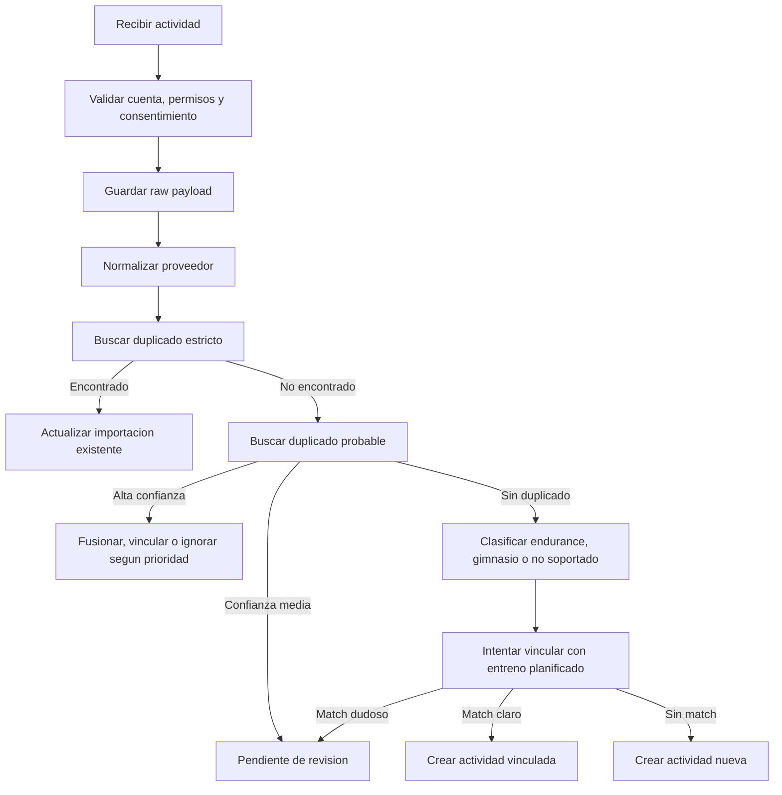

# Resolucion de entrenos importados en Alzan

Fecha de referencia: 2026-05-01

Este documento define como deberia decidir Alzan que hacer cuando recibe un entrenamiento desde Apple Health, Android Health Connect, Strava, Garmin, Suunto u otra fuente externa.

Es una propuesta de producto, backend y datos. No describe una funcionalidad ya implementada.

## Objetivo

Cuando entra un entreno externo, Alzan no debe crear una sesion a ciegas.

Debe decidir si ese entreno:

- crea una actividad nueva;
- actualiza una actividad importada antes;
- se vincula a un entreno planificado;
- se considera duplicado;
- queda pendiente de revision;
- se ignora por permisos, baja confianza o conflicto.

La regla principal es proteger la confianza del usuario: mejor pedir revision en casos dudosos que duplicar entrenos, pisar datos manuales o mezclar gimnasio con endurance de forma incorrecta.

## Principios

1. Guardar el dato bruto antes de transformarlo.
2. Normalizar todos los proveedores a un modelo comun.
3. Separar idempotencia estricta de deteccion difusa de duplicados.
4. No sobrescribir datos manuales sin confirmacion.
5. Usar prioridad de fuentes para resolver solapes.
6. Mantener trazabilidad entre dato externo, raw payload y `activity_sessions`.
7. Marcar como pendiente cualquier importacion que pueda cambiar el historial del usuario de forma ambigua.

## Datos minimos de entrada

Cada actividad normalizada deberia intentar incluir:

| Campo | Uso |
| --- | --- |
| `user_id` | Propietario del dato. |
| `provider` | Fuente original o agregador que entrega la actividad. |
| `provider_activity_id` | Id externo si existe. |
| `external_account_id` | Cuenta conectada que entrego el dato. |
| `source_device` | Dispositivo o app que genero la actividad si el proveedor lo informa. |
| `sport_type` | Tipo canonico de deporte. |
| `sport_subtype` | Variante si aplica. |
| `start_time` | Inicio en UTC. |
| `end_time` | Fin en UTC si existe. |
| `timezone` | Zona horaria original. |
| `duration_s` | Duracion total. |
| `moving_duration_s` | Duracion en movimiento si existe. |
| `distance_m` | Distancia si aplica. |
| `calories_kcal` | Energia si existe. |
| `route_polyline` | Ruta simplificada si existe. |
| `streams` | Pulso, potencia, cadencia, velocidad, altitud, distancia o temperatura. |
| `gym_sets` | Ejercicios, series, reps, peso, tiempo o descanso si existe. |
| `raw_payload_id` | Referencia al payload original guardado. |

Si faltan campos clave como `provider_activity_id`, `start_time` o `duration_s`, la actividad puede entrar, pero debe usar reglas de baja confianza.

## Pipeline de decision



## Estados recomendados

La importacion necesita estados propios, aunque `activity_sessions.status` siga representando el estado de la sesion.

| Estado | Significado |
| --- | --- |
| `received` | El proveedor envio la actividad y el raw payload se guardo. |
| `normalized` | El payload se convirtio a modelo comun. |
| `imported` | Se creo o actualizo `activity_sessions`. |
| `linked_to_plan` | Se vinculo a un entreno planificado o plantilla. |
| `duplicate_ignored` | Se detecto duplicado y no se creo nueva sesion. |
| `merged` | Se combinaron datos de fuentes distintas en una sesion canonica. |
| `pending_review` | El usuario debe revisar una decision dudosa. |
| `unsupported` | El tipo de actividad no se puede importar todavia. |
| `failed` | Error tecnico o dato invalido. |

Estos estados pueden vivir en una tabla nueva de resolucion, en `wearable_sync_jobs.payload`, o en una evolucion de `external_activity_mappings`. La decision final deberia tomarse al implementar las migraciones.

## Idempotencia estricta

La primera barrera es determinista.

Una actividad es la misma si coincide:

```text
user_id + provider + provider_activity_id
```

Accion:

- Si existe mapping en `external_activity_mappings`, actualizar la `activity_session` asociada si el nuevo payload aporta datos mejores.
- Si existe `activity_sessions.provider_activity_id` para el mismo usuario y proveedor, crear el mapping que falte y actualizar.
- Si el payload es identico o mas pobre, guardar raw y marcar como `duplicate_ignored`.

Esta regla evita duplicados por reintentos, webhooks repetidos y backfills que reenvian actividades ya importadas.

## Deteccion difusa de duplicados

Si no hay `provider_activity_id` o el proveedor entrega IDs distintos para la misma actividad, se debe comparar por ventana temporal y metadatos.

Senales recomendadas:

| Senal | Ejemplo |
| --- | --- |
| Tiempo | Inicio dentro de una ventana de 2 a 5 minutos. |
| Duracion | Diferencia menor al 5 por ciento o menor a 2 minutos. |
| Deporte | `running` con `running`, `cycling` con `cycling`, gimnasio con gimnasio. |
| Distancia | Diferencia menor al 3 por ciento en endurance. |
| Ruta | Polyline o puntos inicial/final similares. |
| Pulso | Media o curva parecida si existe. |
| Dispositivo | Mismo reloj, bici, app o sensor. |
| Nombre | Nombre parecido, solo como senal debil. |

Resultado recomendado:

| Confianza | Accion |
| --- | --- |
| Alta | Fusionar o ignorar duplicado usando prioridad de fuente. |
| Media | Crear `pending_review` para que el usuario decida. |
| Baja | Crear actividad nueva. |

Nunca se debe fusionar automaticamente una actividad de gimnasio con una de endurance aunque coincidan tiempos, salvo que el proveedor indique claramente que es la misma sesion mixta.

## Prioridad de fuentes

La prioridad se usa cuando dos fuentes describen el mismo entreno o el mismo dato.

No significa borrar la fuente de menor prioridad. Significa decidir que version alimenta la vista principal, los calculos y los resumenes.

### Ranking base

| Prioridad | Fuente | Regla |
| --- | --- | --- |
| 1 | Manual del usuario | Nunca se pisa sin confirmacion. |
| 2 | Dispositivo primario elegido por el usuario | Fuente preferida para entrenos y metricas del reloj principal. |
| 3 | Proveedor cloud directo del dispositivo | Garmin Connect, Suunto o Polar cuando vienen del fabricante. |
| 4 | App deportiva directa | Strava si la actividad fue creada o grabada ahi. |
| 5 | Agregador del sistema operativo | Apple Health o Android Health Connect si solo actuan como copia. |
| 6 | Agregador externo | Datos reenviados desde otra app sin origen claro. |
| 7 | Importacion manual de archivo | FIT/TCX/GPX/CSV si no hay cuenta conectada o metadata fiable. |

### Ajustes por usuario

El usuario deberia poder elegir un dispositivo o proveedor principal para entrenos.

Ejemplo:

```text
Proveedor principal de entrenos: Garmin
Proveedor principal de salud diaria: Apple Health
```

Con eso, Alzan puede aceptar que Garmin gane para actividad deportiva, pero Apple Health gane para pasos diarios o sueno si Garmin no tiene datos completos.

### Prioridad por campo

La prioridad no tiene que ser global para toda la actividad.

Ejemplo:

- Garmin puede ganar en distancia, potencia, altitud y dispositivo.
- Strava puede aportar segmentos o nombre editado por el usuario.
- Apple Health puede aportar energia activa o frecuencia cardiaca si Garmin no envio streams.

Regla recomendada:

1. La actividad canonica vive en una unica `activity_sessions`.
2. Cada proveedor conserva su mapping y raw payload.
3. Los campos principales se rellenan desde la fuente ganadora por campo.
4. Los campos manuales editados por el usuario quedan bloqueados salvo confirmacion.

## Acciones posibles al recibir un entreno

| Caso | Accion recomendada |
| --- | --- |
| Mismo `provider_activity_id` | Actualizar importacion existente. |
| Duplicado claro de proveedor de menor prioridad | Guardar raw, mapping y marcar como `duplicate_ignored`. |
| Duplicado claro con datos mejores | Fusionar campos no manuales y marcar como `merged`. |
| Duplicado dudoso | Mandar a `pending_review`. |
| Actividad coincide con entreno planificado | Crear sesion y vincular a `workout_template_id` o `endurance_template_id` si el match es claro. |
| Actividad se solapa con entreno manual completado | No pisar; crear `pending_review`. |
| Actividad nueva y soportada | Crear `activity_sessions`. |
| Tipo no soportado | Guardar raw y marcar `unsupported`. |
| Falta consentimiento | No proyectar a Training/Health; registrar como rechazado o descartar segun politica. |

## Vinculacion con entrenos planificados

Cuando un entreno importado coincide con algo que el usuario tenia planificado, Alzan deberia intentar vincularlo.

Senales para match:

- fecha del plan;
- ventana horaria;
- tipo de deporte;
- duracion esperada;
- distancia o volumen esperado;
- plantilla activa;
- nombre parecido;
- si el usuario inicio un entreno en Alzan cerca de esa hora.

Acciones:

- Si el match es claro, vincular automaticamente.
- Si hay varios candidatos, pedir revision.
- Si el entreno planificado ya esta completado manualmente, no sobrescribirlo.
- Si la actividad importada solo aporta resumen y el entreno de Alzan tiene detalle mejor, conservar el detalle de Alzan.

## Endurance

Para endurance, la importacion deberia crear o actualizar `activity_sessions` con:

- `sport_type` y `sport_subtype`;
- `start_time`, `end_time`, `duration_s` y `timezone`;
- `distance_m`;
- `calories_kcal`;
- `avg_heart_rate` y `max_heart_rate`;
- `avg_power_w` y `max_power_w`;
- `avg_cadence` y `max_cadence`;
- `elev_gain_m` y `elev_loss_m` si existen;
- `route_polyline`;
- `device_id`;
- `provider` y `provider_activity_id`;
- `imported_at`.

Los streams se guardan en `activity_streams` cuando existan.

Reglas especificas:

- Si la actividad trae ruta y otra fuente no, conservar ruta.
- Si hay laps/splits, se deberia planificar una tabla o modelo especifico antes de perderlos.
- Si una fuente trae potencia nativa de dispositivo, debe ganar sobre potencia estimada.
- Si Strava entrega datos recortados por privacidad, no debe reemplazar rutas completas de la fuente directa.

## Gimnasio

Para gimnasio, la importacion es mas delicada porque los proveedores pueden traer nombres de ejercicios, series incompletas o solo duracion/calorias.

Reglas recomendadas:

- No crear ejercicios nuevos en la libreria de Alzan sin revision.
- Mapear ejercicios externos contra la libreria existente con confianza.
- Si un ejercicio no se reconoce, dejarlo como pendiente de mapping.
- No modificar rutinas o plantillas del usuario automaticamente.
- Crear una `activity_sessions` de gimnasio aunque no haya detalle de series, si el resumen es valido.
- Si hay series, guardarlas solo cuando el modelo de datos soporte su trazabilidad desde proveedor.

Estados utiles para gimnasio:

| Estado | Significado |
| --- | --- |
| `gym_summary_only` | Solo se importo duracion, calorias o pulso. |
| `gym_sets_imported` | Se importaron series con confianza suficiente. |
| `gym_exercise_mapping_needed` | Hay ejercicios externos sin equivalente claro. |
| `gym_conflict_with_alzan_session` | Se solapa con una sesion interactiva de Alzan. |

Decision importante: si el usuario completo un entreno interactivo en Alzan, esa sesion debe ganar sobre un resumen externo salvo que el usuario decida fusionar datos.

## UI recomendada

Crear una bandeja de revision llamada, por ejemplo, `Actividades importadas`.

Estados visibles:

- Nueva actividad importada.
- Posible duplicado.
- Vincular con entreno planificado.
- Revisar ejercicios de gimnasio.
- Ignorada por duplicado.
- Error de sincronizacion.

Acciones para el usuario:

- `Aceptar importacion`.
- `Vincular a entreno`.
- `Mantener separadas`.
- `Fusionar`.
- `Ignorar`.
- `Elegir esta fuente como principal`.

La app no deberia interrumpir al usuario por cada actividad. Solo deberia pedir decision cuando el resultado afecte historial, progreso o datos manuales.

## Observabilidad

Cada decision deberia poder responder:

- que proveedor envio el dato;
- cuando lo envio;
- que raw payload se recibio;
- que actividad canonica se creo o actualizo;
- que regla de deduplicacion se aplico;
- que fuente gano cada campo importante;
- si hubo intervencion del usuario;
- si fallo, que error y si se reintentara.

Esto puede registrarse en `wearable_sync_jobs`, `external_activity_mappings`, `wearable_raw_payloads` y una futura tabla de eventos de resolucion si hace falta.

## Checks antes de implementar

- Confirmar si `activity_sessions` necesita campos de bloqueo para datos editados manualmente.
- Definir donde viven los estados de resolucion.
- Definir si se permite una relacion muchos-a-uno entre mappings externos y una misma `activity_sessions`.
- Definir tabla para splits/laps antes de importar endurance avanzado.
- Definir modelo de series importadas antes de aceptar gimnasio detallado.
- Definir UI de revision antes de activar fusion automatica.
- Definir preferencias de proveedor principal por tipo de dato.

## Referencias locales

- `docs/wearables.md`
- `docs/wearables-simple-summary.md`
- `docs/open-wearables-reference/wearable-integration-architecture.mdx`
- `alzan-fe/src/types/database.types.ts`
- `supabase/migrations/20260110171026_remote_schema.sql`
