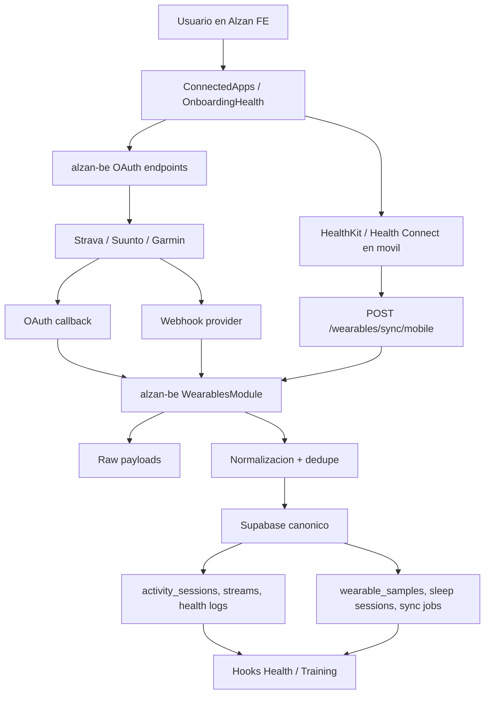

# Integracion de wearables en Alzan

Fecha de referencia: 2026-04-27

Este documento define como integraria Alzan con Apple Health, Android Health Connect, Strava, Garmin y Suunto. Es una propuesta de arquitectura y roadmap, no una descripcion de una funcionalidad ya implementada.

El objetivo es que Alzan pueda importar actividad, salud y entrenamiento de multiples fuentes sin convertir el frontend en un lugar inseguro para secretos, tokens o reglas complejas de normalizacion.

Documentos complementarios:

- `docs/wearables-simple-summary.md`: resumen muy simple para entender la idea general antes de entrar en la arquitectura.
- `docs/open-wearables-reference/wearable-integration-architecture.mdx`: arquitectura de referencia tomada del repo Open Wearables.
- `docs/open-wearables-reference/how-to-add-new-provider.mdx`: guia de referencia para entender como estructurar un proveedor nuevo.

## Lectura rapida

Alzan ya tiene parte del terreno preparado:

- El frontend Expo/React Native tiene pantallas de integraciones, pero estan en modo placeholder: `alzan-fe/src/screens/settings/ConnectedAppsScreen.tsx`, `alzan-fe/src/screens/training/ExternalActivityLinkingScreen.tsx` y `alzan-fe/src/screens/onboarding/OnboardingHealth.tsx`.
- El backend NestJS existe, pero hoy es una capa fina: `alzan-be/src/components/user/user.controller.ts`, `alzan-be/src/components/supabase/supabase.service.ts` y `alzan-be/src/core/guards/auth.guard.ts`.
- Supabase es el centro real de datos. Ya existen tablas utiles para workouts, streams, dispositivos y cuentas externas: `activity_sessions`, `activity_streams`, `devices`, `external_accounts`, `external_activity_mappings`, `external_raw_payloads`, `weight_logs`, `sleep_logs`, `resting_hr_logs` y `user_preferences`.

La decision principal es usar una arquitectura hibrida:

- Apple Health y Android Health Connect se leen desde el movil, porque sus datos viven en el dispositivo y requieren permisos nativos del usuario.
- Strava, Suunto y Garmin se gestionan desde el backend, porque usan OAuth, webhooks, backfills, secretos de aplicacion y tokens renovables.
- Supabase guarda el dato canonico normalizado.
- El frontend solo inicia conexiones, muestra estados y dispara sincronizaciones. No guarda client secrets ni refresh tokens de proveedores.

## Estado actual verificado

### Frontend

`ConnectedAppsScreen` lista Suunto, Strava, Garmin, Apple Health y Google Fit como proximamente. No llama a ningun servicio real y sus callbacks estan vacios.

`ExternalActivityLinkingScreen` tiene estado local simulado para Suunto y Strava. El toggle muestra un dialogo y cambia un booleano local, pero no persiste la conexion ni ejecuta OAuth.

`OnboardingHealth` detecta plataforma iOS/Android y muestra Apple Health o Google Health Connect, pero tambien esta marcado como proximamente.

La app ya tiene infraestructura para consumir el backend por OpenAPI:

- `alzan-fe/src/openapi/generated/alzan-be/*`
- `alzan-fe/src/context/AlzanBackendClientContext.tsx`
- `EXPO_PUBLIC_ALZAN_BACKEND_BASE_URL` en `alzan-fe/src/constants/environment.tsx`

Para esta integracion, las llamadas nuevas al backend deberian pasar por el cliente OpenAPI generado, no por `fetch` directo dentro de componentes.

### Backend

`alzan-be` usa NestJS, Supabase service role y un guard global basado en bearer token de Supabase. Esto encaja bien con endpoints autenticados para conexiones de usuario y endpoints publicos controlados para OAuth callbacks y webhooks.

El backend debe convertirse en la frontera segura de integraciones:

- Construir URLs OAuth.
- Validar `state`.
- Intercambiar authorization codes por tokens.
- Refrescar tokens.
- Recibir webhooks.
- Validar firmas o verify tokens.
- Guardar raw payloads.
- Normalizar datos.
- Resolver idempotencia.
- Escribir en Supabase con service role.

### Base de datos

El esquema actual ya cubre una parte importante:

- `activity_sessions`: sesion de entrenamiento o actividad importada. Incluye `source`, `provider`, `provider_activity_id`, `device_id`, distancia, frecuencia cardiaca, potencia, cadencia, temperatura, calorias, pasos, VO2 max y polyline.
- `activity_streams`: series por sesion, como frecuencia cardiaca, potencia, cadencia, altitud, velocidad, distancia o temperatura.
- `devices`: dispositivo asociado a un usuario y proveedor.
- `external_accounts`: base inicial para cuentas de proveedor externo.
- `external_activity_mappings`: relacion entre una actividad externa y una `activity_session`.
- `external_raw_payloads`: payload crudo asociado a un mapping.
- `weight_logs`, `sleep_logs`, `resting_hr_logs`: datos de salud que ya consume el modulo Health.
- `user_preferences`: contiene `health_data_consent` e `import_health_metrics`, que deben gobernar importacion de salud.

Limitacion actual: las tablas existentes estan muy orientadas a workouts y resumen de salud. Para pasos diarios, HRV, SpO2, sueño por fases, temperatura corporal, recovery, readiness o muestras 24/7 hace falta una capa nueva de ingestion y metricas.

## Arquitectura propuesta



### Responsabilidades

| Capa | Responsabilidad |
| --- | --- |
| Frontend | Pedir permisos nativos, iniciar OAuth, mostrar estado, sincronizar datos del movil, refrescar queries. |
| Backend | Proteger secretos, OAuth, webhooks, token refresh, validacion, normalizacion, idempotencia, observabilidad. |
| Supabase | Persistencia canonica, Row Level Security, datos raw, tablas de proyeccion para Health y Training. |
| Proveedores | Entregar datos via SDK local, REST, webhook ping o webhook stream segun proveedor. |

### Patron de providers

Conviene implementar un modulo `WearablesModule` en NestJS con adaptadores por proveedor:

```text
alzan-be/src/components/wearables/
├── wearables.controller.ts
├── wearables.module.ts
├── wearables.service.ts
├── dto/
├── providers/
│   ├── apple-health.adapter.ts
│   ├── health-connect.adapter.ts
│   ├── strava.adapter.ts
│   ├── suunto.adapter.ts
│   └── garmin.adapter.ts
├── normalizers/
│   ├── workout.normalizer.ts
│   ├── sleep.normalizer.ts
│   └── sample.normalizer.ts
└── repositories/
    └── wearable.repository.ts
```

Cada adaptador debe declarar:

- `provider`: identificador interno.
- `capabilities`: `mobile_sdk`, `oauth`, `rest_pull`, `webhook_ping`, `webhook_stream`, `file_import`.
- `requiredScopes`: permisos que se pediran al usuario.
- `buildAuthorizeUrl`: solo para OAuth.
- `exchangeCode`: solo para OAuth.
- `refreshToken`: si el proveedor emite refresh token.
- `validateWebhook`: firma, verify token o HMAC.
- `normalizeWorkout`, `normalizeSleep`, `normalizeSample`: transformacion a formato canonico.

## Modelo de datos recomendado

### Reutilizar tablas existentes

No conviene duplicar lo que la app ya sabe leer.

| Tipo de dato importado | Tabla Alzan actual | Regla |
| --- | --- | --- |
| Workout/ruta/actividad | `activity_sessions` | Crear o actualizar por `provider + provider_activity_id`. |
| Streams de actividad | `activity_streams` | Guardar series por `session_id` y `stream_type`. |
| Dispositivo | `devices` | Resolver por `user_id + provider + device_serial/device_model`. |
| Peso y composicion | `weight_logs` | Insertar solo si `import_health_metrics = true`. |
| Sueño resumen | `sleep_logs` | Guardar resumen para pantallas actuales. |
| FC reposo | `resting_hr_logs` | Guardar lectura diaria o mas reciente segun proveedor. |
| Consentimiento | `user_preferences` | Respetar `health_data_consent` e `import_health_metrics`. |

### Extender enums existentes

El esquema tiene `provider_enum` y `activity_source_enum`. Para evitar mapear todo a `other`, hay que ampliarlos:

```sql
alter type provider_enum add value if not exists 'apple_health';
alter type provider_enum add value if not exists 'android_health_connect';
alter type provider_enum add value if not exists 'suunto';

alter type activity_source_enum add value if not exists 'apple_health';
alter type activity_source_enum add value if not exists 'android_health_connect';
alter type activity_source_enum add value if not exists 'suunto';
```

`strava` y `garmin` ya aparecen en los enums actuales. `suunto`, `apple_health` y `android_health_connect` no.

### Evolucionar `external_accounts`

La tabla actual sirve como base, pero para produccion necesita mas campos:

```sql
alter table public.external_accounts
  add column if not exists status text not null default 'active',
  add column if not exists provider_user_id text,
  add column if not exists access_token_encrypted text,
  add column if not exists refresh_token_encrypted text,
  add column if not exists last_synced_at timestamptz,
  add column if not exists revoked_at timestamptz,
  add column if not exists metadata jsonb not null default '{}'::jsonb;
```

Recomendacion: dejar de usar `access_token` y `refresh_token` en claro. Mantenerlos temporalmente solo durante migracion, cifrar tokens nuevos y limpiar columnas antiguas cuando no haya dependencias.

Indice recomendado:

```sql
create unique index if not exists external_accounts_user_provider_unique
  on public.external_accounts (user_id, provider)
  where revoked_at is null;
```

### Nuevas tablas

#### `wearable_sync_jobs`

Controla sincronizaciones historicas, reintentos y webhooks pesados.

Campos recomendados:

- `id uuid primary key`
- `user_id uuid references public.users(id)`
- `provider text not null`
- `job_type text not null`: `historical_backfill`, `webhook_event`, `mobile_sync`, `token_refresh`
- `status text not null`: `queued`, `processing`, `succeeded`, `failed`, `cancelled`
- `attempts integer not null default 0`
- `available_at timestamptz not null default now()`
- `started_at timestamptz`
- `finished_at timestamptz`
- `error_code text`
- `error_message text`
- `cursor jsonb not null default '{}'::jsonb`
- `payload jsonb not null default '{}'::jsonb`
- `created_at timestamptz not null default now()`
- `updated_at timestamptz not null default now()`

Indices:

```sql
create index wearable_sync_jobs_queue_idx
  on public.wearable_sync_jobs (status, available_at, provider);

create index wearable_sync_jobs_user_provider_idx
  on public.wearable_sync_jobs (user_id, provider, created_at desc);
```

#### `wearable_samples`

Guarda muestras de salud que no encajan en las tablas actuales.

Ejemplos: HRV, SpO2, pasos diarios, energia activa, energia basal, temperatura, respiratory rate, mindfulness minutes, recovery score.

Campos recomendados:

- `id uuid primary key`
- `user_id uuid not null references public.users(id)`
- `provider text not null`
- `device_id uuid references public.devices(id)`
- `metric text not null`
- `unit text not null`
- `recorded_at timestamptz not null`
- `recorded_date date`
- `timezone text`
- `value_numeric numeric`
- `value_text text`
- `value_json jsonb`
- `external_id text`
- `source_priority integer not null default 100`
- `created_at timestamptz not null default now()`

Clave de idempotencia:

```sql
create unique index wearable_samples_dedupe_idx
  on public.wearable_samples (
    user_id,
    provider,
    metric,
    recorded_at,
    coalesce(external_id, ''),
    coalesce(device_id::text, '')
  );
```

#### `wearable_sleep_sessions`

`sleep_logs` sirve para resumen, pero no para fases. Esta tabla conserva el detalle.

Campos recomendados:

- `id uuid primary key`
- `user_id uuid not null references public.users(id)`
- `provider text not null`
- `device_id uuid references public.devices(id)`
- `external_id text`
- `sleep_start timestamptz not null`
- `sleep_end timestamptz not null`
- `timezone text`
- `duration_min integer`
- `in_bed_min integer`
- `awake_min integer`
- `light_min integer`
- `deep_min integer`
- `rem_min integer`
- `efficiency numeric`
- `quality_score integer`
- `stages jsonb not null default '[]'::jsonb`
- `created_at timestamptz not null default now()`

Proyeccion: crear o actualizar un `sleep_logs` por noche para que las pantallas actuales sigan funcionando.

#### Raw payloads genericos

`external_raw_payloads` depende de `external_activity_mapping_id`, por lo que no sirve bien para payloads que no sean actividades. Para salud 24/7 conviene crear una tabla generica:

```sql
create table public.wearable_raw_payloads (
  id uuid primary key default gen_random_uuid(),
  user_id uuid references public.users(id) on delete cascade,
  provider text not null,
  event_type text not null,
  external_id text,
  payload jsonb not null,
  received_at timestamptz not null default now(),
  processed_at timestamptz,
  processing_error text
);
```

Guardar raw primero permite replay, auditoria, debug y normalizadores mas seguros.

## API propuesta

Todos los endpoints autenticados deben usar el bearer token Supabase que ya maneja `AuthGuard`. Los callbacks OAuth y webhooks son publicos en el sentido de NestJS, pero deben validar `state`, firma, HMAC o verify token.

| Metodo | Endpoint | Auth | Uso |
| --- | --- | --- | --- |
| `GET` | `/wearables/providers` | Usuario | Lista proveedores soportados, capacidades y permisos. |
| `GET` | `/wearables/connections` | Usuario | Estado de conexiones del usuario. |
| `POST` | `/wearables/connections/:provider/authorize` | Usuario | Devuelve URL OAuth o instrucciones mobile SDK. |
| `GET` | `/wearables/connections/:provider/callback` | Publico validado | Recibe OAuth callback y cierra conexion. |
| `DELETE` | `/wearables/connections/:provider` | Usuario | Revoca/desconecta proveedor. |
| `POST` | `/wearables/sync/mobile` | Usuario | Recibe batch normalizado o semi-normalizado desde Apple/Android. |
| `POST` | `/wearables/sync/:provider` | Usuario | Lanza sincronizacion historica/manual. |
| `POST` | `/wearables/webhooks/:provider` | Publico validado | Recibe eventos de Strava, Suunto o Garmin. |
| `GET` | `/wearables/sync-jobs/:id` | Usuario | Consulta estado de un job. |

### Respuestas recomendadas

`GET /wearables/connections`:

```json
{
  "connections": [
    {
      "provider": "strava",
      "status": "active",
      "displayName": "Strava",
      "lastSyncedAt": "2026-04-27T10:00:00Z",
      "scopes": ["read", "activity:read_all"],
      "capabilities": ["oauth", "rest_pull", "webhook_ping"]
    }
  ]
}
```

`POST /wearables/connections/strava/authorize`:

```json
{
  "provider": "strava",
  "type": "oauth",
  "authorizationUrl": "https://www.strava.com/oauth/authorize?...",
  "stateExpiresAt": "2026-04-27T10:10:00Z"
}
```

`POST /wearables/sync/mobile`:

```json
{
  "provider": "apple_health",
  "device": {
    "name": "Apple Watch",
    "model": "Watch",
    "systemVersion": "iOS 18"
  },
  "samples": [],
  "workouts": [],
  "sleepSessions": [],
  "syncCursor": {
    "lastAnchors": {}
  }
}
```

## Flujos por proveedor

### Apple Health

Apple Health se integra con HealthKit. HealthKit requiere permisos explicitos por tipo de dato y se ejecuta en iOS/watchOS. La app debe declarar textos de uso en `Info.plist`, como `NSHealthShareUsageDescription` para leer datos de salud y `NSHealthUpdateUsageDescription` si algun dia escribe datos.

Flujo recomendado:

1. El usuario llega a `OnboardingHealth` o `ConnectedAppsScreen`.
2. La app muestra los tipos de dato que quiere leer: workouts, pasos, frecuencia cardiaca, peso, composicion corporal, sueño y HRV.
3. iOS abre el prompt nativo de HealthKit.
4. El modulo nativo lee datos de forma incremental.
5. El frontend envia batches a `POST /wearables/sync/mobile`.
6. El backend valida consentimiento, deduplica, normaliza y proyecta.

Decisiones importantes:

- Leer HealthKit requiere build nativa o dev client, no basta Expo Go.
- El backend no puede leer Apple Health directamente. El movil actua como puente.
- Guardar el cursor/anchor de lectura por usuario y dispositivo evita reimportar todo.
- Para MVP, importar workouts, peso, sueño resumido y FC reposo antes que metricas 24/7 mas complejas.

### Android Health Connect

Health Connect es la capa moderna de Android para leer y escribir datos de salud y fitness de varias apps. La integracion requiere permisos por tipo de dato y, para publicar en Play Store, declarar el uso de permisos sensibles de Health Connect.

Flujo recomendado:

1. El usuario abre `OnboardingHealth` o integraciones.
2. La app comprueba si Health Connect esta disponible.
3. La app solicita permisos de lectura para registros concretos.
4. El modulo nativo lee datos por ventana temporal.
5. El frontend sube batches a `POST /wearables/sync/mobile`.
6. El backend normaliza y proyecta.

Decisiones importantes:

- Sustituir el texto actual de "Google Fit" por "Health Connect" en la UI tecnica. Google Fit como API historica no deberia ser la base de una integracion nueva.
- La app debe declarar permisos Android para los data types que vaya a leer.
- Hay que preparar la declaracion de permisos de Health Connect en Google Play.

### Strava

Strava debe ir por backend. La app no debe conocer el client secret ni guardar refresh tokens.

Flujo OAuth:

1. Frontend llama a `POST /wearables/connections/strava/authorize`.
2. Backend genera `state` firmado con usuario, proveedor, nonce y expiracion.
3. Frontend abre la URL con `expo-web-browser`.
4. Strava redirige a `/wearables/connections/strava/callback`.
5. Backend valida `state`, intercambia `code` por tokens y guarda la conexion.
6. Backend lanza un backfill inicial.

Flujo webhook:

1. Strava envia una verificacion inicial con `hub.challenge` y `verify_token`.
2. Despues envia eventos ligeros cuando una actividad cambia.
3. El backend usa el `owner_id` y el activity id para localizar la conexion.
4. El backend llama a la API de Strava para descargar el detalle real.
5. La actividad se normaliza hacia `activity_sessions` y, si aplica, `activity_streams`.

Datos utiles:

- Workouts de running/cycling/swimming/otros.
- Distancia, tiempo, elevacion, calorias si disponible.
- Polyline/ruta.
- Streams disponibles segun permisos y datos.

### Suunto

Suunto usa API de partner. Normalmente combina OAuth2, cabeceras especificas como subscription key y webhooks para notificar workouts o datos.

Flujo recomendado:

1. Solicitar acceso de desarrollador/partner.
2. Configurar client id, client secret, redirect URL y subscription key en backend.
3. Implementar OAuth en `alzan-be`.
4. Registrar webhooks con HMAC/secret si el plan de API lo permite.
5. Procesar workouts, FIT files si estan disponibles y datos 24/7 cuando el usuario haya dado permisos.

Decisiones importantes:

- Tratar Suunto como proveedor cloud, no como lectura directa del reloj.
- Guardar payload raw antes de normalizar.
- No prometer metricas 24/7 hasta confirmar permisos y endpoints del acuerdo Suunto.

### Garmin

Garmin tiene dos vias relevantes:

- Garmin Health API: integracion cloud para datos de salud y actividad, pensada para partners aprobados.
- Garmin Health SDK: opcion enterprise para conectar directamente con dispositivos Garmin desde una app propia.

Para Alzan, la recomendacion es empezar por Garmin Health API si se consigue acceso. El SDK directo tiene mas coste de integracion, soporte y compatibilidad.

Flujo recomendado con Health API:

1. Solicitar acceso a Garmin Developer.
2. Configurar consumer key/secret o credenciales requeridas.
3. Implementar autorizacion de usuario segun el flujo aprobado por Garmin.
4. Recibir notificaciones/backfills desde Garmin.
5. Procesar actividades, salud diaria, sueño, body battery, stress, HRV u otros tipos permitidos por el contrato.

Decisiones importantes:

- Garmin suele requerir aprobacion del caso de uso. Esta fase depende de partner access.
- Hay que aislar Garmin en adaptador propio porque sus formatos y procesos de backfill son distintos a Strava.
- Para MVP, no bloquear la arquitectura esperando Garmin; implementar Strava y mobile health primero.

## Pipeline de gestion de datos

El pipeline debe ser igual para todos los proveedores:

1. Recibir evento, batch o callback.
2. Validar autenticacion, firma, HMAC, verify token o bearer token.
3. Validar consentimiento del usuario.
4. Guardar raw payload.
5. Resolver usuario, proveedor, cuenta y dispositivo.
6. Normalizar a modelos canonicos.
7. Deducir clave de idempotencia.
8. Upsert en tablas canonicas.
9. Proyectar a tablas actuales de Health y Training.
10. Registrar job, errores y timestamps.
11. Invalidar/refrescar queries en frontend tras sync manual.

### Normalizacion de unidades

| Magnitud | Unidad canonica |
| --- | --- |
| Peso | kg |
| Distancia | m |
| Duracion | s o min segun tabla destino |
| Energia | kcal |
| Frecuencia cardiaca | bpm |
| Potencia | W |
| Temperatura | Celsius |
| Timestamps | UTC + timezone original |

### Idempotencia

Workouts:

- Clave primaria logica: `user_id + provider + provider_activity_id`.
- Si el proveedor reenvia la misma actividad, actualizar campos existentes en vez de duplicar.
- Guardar relacion en `external_activity_mappings`.

Samples:

- Clave primaria logica: `user_id + provider + metric + recorded_at + device_id/external_id`.
- Si dos fuentes agregan el mismo dato, usar prioridad de fuente.

Sueño:

- Clave primaria logica: `user_id + provider + external_id`.
- Si falta `external_id`, usar ventana temporal con tolerancia.

### Prioridad de fuentes

Cuando hay datos duplicados o solapados:

1. Manual del usuario.
2. Dispositivo primario elegido por el usuario.
3. Proveedor cloud directo del dispositivo.
4. Agregador del sistema operativo.
5. Agregadores de terceros.

Ejemplo: si el usuario introduce peso manualmente y Apple Health envia otro peso el mismo dia, no se debe sobrescribir el manual sin confirmacion. Si `import_health_metrics = false`, los datos importados pueden guardarse como raw/canonico, pero no deben alimentar calculos de composicion corporal.

## Frontend propuesto

### `ConnectedAppsScreen`

Debe pasar de lista estatica a vista real:

- Query `GET /wearables/providers`.
- Query `GET /wearables/connections`.
- Boton conectar.
- Boton desconectar.
- Estado: conectado, desconectado, sincronizando, error, pendiente de permisos.
- `lastSyncedAt`.
- Etiqueta por tipo: sistema, proveedor cloud, partner requerido.

Acciones:

- Apple/Android: pedir permisos nativos y llamar sync mobile.
- Strava/Suunto/Garmin: abrir OAuth o mostrar "pendiente de aprobacion" si el proveedor no esta habilitado en backend.

### `ExternalActivityLinkingScreen`

Ahora duplica parte de Settings. Recomendacion:

- Convertirla en wrapper que reutilice el mismo componente de integraciones.
- O redirigir desde Training a `ConnectedApps`.
- Mantener textos orientados a actividades, pero no estado local simulado.

### `OnboardingHealth`

Debe activar el flujo nativo:

- Mostrar Apple Health en iOS y Health Connect en Android.
- Explicar permisos con lenguaje claro.
- Permitir "Ahora no".
- Si el usuario acepta, pedir permisos y crear conexion local.
- Despues ir a consentimiento general si corresponde.

### Hooks y servicios

Crear una capa `src/modules/integrations` o `src/modules/wearables`:

```text
alzan-fe/src/modules/wearables/
├── hooks/
│   ├── useWearableProviders.ts
│   ├── useWearableConnections.ts
│   └── useWearableSync.ts
├── services/
│   └── wearableApi.ts
├── components/
│   └── WearableProviderCard.tsx
└── types.ts
```

`wearableApi.ts` debe envolver el cliente OpenAPI generado. Los componentes no deben llamar directamente a Supabase ni a `fetch` para integraciones.

## Seguridad, privacidad y cumplimiento

### Tokens y secretos

- Client secrets solo en `alzan-be`.
- Refresh tokens cifrados antes de guardarse.
- Rotar encryption key con estrategia de versionado.
- No loguear tokens, authorization codes, headers OAuth ni payloads sensibles completos.

Variables de entorno backend:

```text
WEARABLE_TOKEN_ENCRYPTION_KEY=
STRAVA_CLIENT_ID=
STRAVA_CLIENT_SECRET=
STRAVA_WEBHOOK_VERIFY_TOKEN=
SUUNTO_CLIENT_ID=
SUUNTO_CLIENT_SECRET=
SUUNTO_SUBSCRIPTION_KEY=
SUUNTO_WEBHOOK_SECRET=
GARMIN_CONSUMER_KEY=
GARMIN_CONSUMER_SECRET=
GARMIN_WEBHOOK_SECRET=
```

### OAuth state

`state` debe incluir:

- `user_id`
- `provider`
- `nonce`
- `redirect_target`
- `expires_at`

Debe ir firmado, expirar rapido y guardarse para evitar replay.

### Webhooks

Cada webhook debe:

- Validar firma, HMAC o verify token segun proveedor.
- Responder rapido.
- Guardar raw payload.
- Crear job si el procesamiento puede tardar.
- Ser idempotente.
- No revelar si un usuario existe.

### RLS

Las nuevas tablas deben tener Row Level Security:

- Usuarios autenticados pueden leer sus propias conexiones no sensibles y sus propios datos.
- Usuarios no deben leer tokens cifrados.
- Escrituras de ingestion deben hacerlas endpoints backend con service role.
- Webhooks no escriben directamente usando credenciales anon.

### Consentimiento

La importacion debe respetar:

- `user_preferences.health_data_consent`
- `user_preferences.import_health_metrics`
- Permisos nativos por tipo de dato.
- Revocacion en proveedor.
- Desconexion desde Alzan.

Desconectar debe ofrecer dos opciones:

- Desconectar y conservar datos historicos.
- Desconectar y borrar datos importados del proveedor.

Para RGPD, la exportacion y borrado de usuario deben incluir nuevas tablas wearable.

## Plan de implementacion recomendado

### Fase 0: Preparacion

- Confirmar permisos legales y politica de privacidad para datos de salud.
- Solicitar accesos de desarrollador: Strava, Suunto y Garmin.
- Decidir libreria nativa para HealthKit y Health Connect compatible con Expo dev client.
- Definir lista MVP de metricas:
  - workouts
  - peso
  - sueño resumen
  - FC reposo
  - pasos diarios

### Fase 1: Strava primero

Strava es el mejor primer proveedor cloud porque su OAuth y webhooks son publicos y documentados.

Entregables:

- Migraciones para conexiones y jobs.
- `WearablesModule`.
- OAuth Strava.
- Backfill inicial de actividades.
- Webhook ping Strava.
- Proyeccion a `activity_sessions`.
- UI real en `ConnectedAppsScreen`.

### Fase 2: Apple Health y Health Connect

Entregables:

- Modulo nativo o libreria compatible.
- Permisos iOS/Android.
- `POST /wearables/sync/mobile`.
- Importacion incremental.
- Proyeccion a `weight_logs`, `sleep_logs`, `resting_hr_logs` y `wearable_samples`.
- Activacion de `OnboardingHealth`.

### Fase 3: Suunto y Garmin

Entregables:

- Adaptadores cloud.
- OAuth o autorizacion segun contrato.
- Webhooks/backfills.
- Normalizadores propios.
- Manejo de metricas avanzadas si el acuerdo lo permite.

### Fase 4: Insights avanzados

Entregables:

- HRV y recovery.
- Sueño por fases.
- Tendencias de carga.
- Alertas por fatiga o baja recuperacion.
- Recomendaciones para entrenamiento y nutricion.

## Riesgos y decisiones pendientes

| Riesgo | Impacto | Mitigacion |
| --- | --- | --- |
| Garmin/Suunto requieren aprobacion partner | Puede bloquear proveedores | No bloquear MVP; empezar con Strava y mobile health. |
| Expo Go no soporta HealthKit/Health Connect | Requiere dev client/build nativa | Planificar EAS/dev client desde fase 2. |
| Datos duplicados entre Apple, Strava y Garmin | Graficos incorrectos | Prioridad de fuentes e idempotencia. |
| Tokens en claro | Riesgo alto de seguridad | Cifrado y no exponer tokens por API. |
| Tablas de muestras muy grandes | Coste/performance | Indices por usuario/fecha/metrica y particionado futuro si crece. |
| Permisos de salud sensibles | Rechazo App Store/Play o incumplimiento | Textos claros, consentimiento granular y declaracion de permisos. |

## Checklist de verificacion

Antes de implementar:

- Confirmar que `docs/wearables.md` sigue separado entre actual y propuesto.
- Revisar que no contiene secretos reales.
- Validar que los proveedores estan documentados con fuentes oficiales.
- Revisar que las nuevas tablas tienen RLS.
- Revisar que la UI no promete Garmin/Suunto como disponible antes de tener acceso.

Durante implementacion:

- Ejecutar migraciones Supabase en local.
- Regenerar tipos Supabase en frontend.
- Regenerar OpenAPI tras agregar endpoints NestJS.
- Ejecutar `pnpm run typecheck`, `pnpm run lint:check` y formato segun el area tocada.
- Probar disconnect, token expirado, webhook duplicado y sync repetida.

## Fuentes oficiales

- Apple HealthKit: https://developer.apple.com/documentation/healthkit
- Apple HealthKit entitlements: https://developer.apple.com/documentation/bundleresources/entitlements/com_apple_developer_healthkit
- Android Health Connect: https://developer.android.com/health-and-fitness/guides/health-connect
- Android Health Connect data types: https://developer.android.com/health-and-fitness/guides/health-connect/plan/data-types
- Android Health Connect publish/declaration guidance: https://developer.android.com/health-and-fitness/guides/health-connect/publish
- Strava authentication: https://developers.strava.com/docs/authentication/
- Strava webhooks: https://developers.strava.com/docs/webhooks/
- Garmin Developer: https://developer.garmin.com/
- Garmin Health API: https://developer.garmin.com/health-api/
- Suunto API Zone: https://apizone.suunto.com/
- Suunto developer docs: https://developer.suunto.com/
